<div align="center">

# Wisp

**An AI companion that lives beside your cursor on your Mac.**<br>
Point at anything, ask out loud, and Wisp answers, shows you where to click, and gets things done.
Private by default: in **Local Only** mode nothing leaves your Mac.

[](https://github.com/SurajMazar/wisp/actions/workflows/ci.yml)


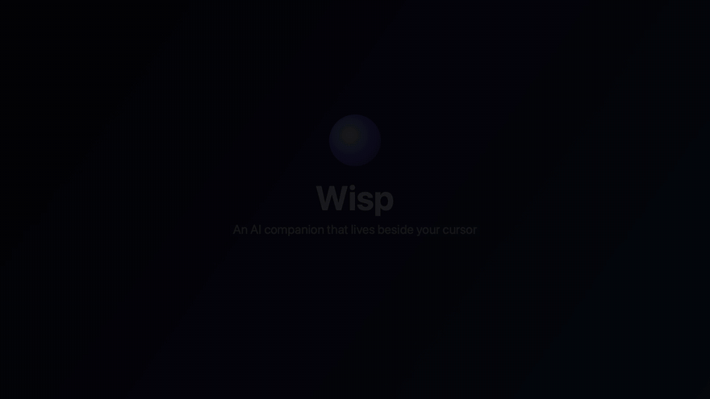

</div>

> **Status:** early development. Everything below is built and tested, but it hasn't been through a public
> release yet. See [PROJECT_STATUS.md](PROJECT_STATUS.md) for the details.

---

## Contents

- [What Wisp does](#what-wisp-does)
- [The notch](#the-notch)
- [The app](#the-app)
- [Shortcuts](#shortcuts)
- [Models and voices](#models-and-voices)
- [Privacy](#privacy)
- [Install](#install)
- [How it works](#how-it-works)
- [Development](#development)
- [Measuring it](#measuring-it)
- [Repository](#repository)

---

## What Wisp does

### Ask about what's on screen, and it points

Hold the shortcut in any app and just ask. Wisp looks at the window you're in, answers out loud, and marks
the exact control you need. It reads native apps through macOS accessibility labels, which makes pointing
exact, and falls back to the screenshot for web pages and icon-only buttons.

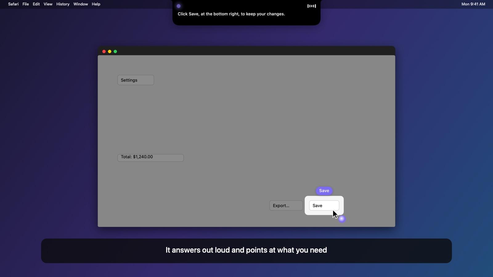

### Draw to show what you mean

While you hold the keys, your pointer becomes a pen. Circle, underline or tick anything, on any display, and
ask "What is this?". Wisp sends the model the picture with your ink on it, and tells it which on-screen text
is inside your mark and which is only nearby.

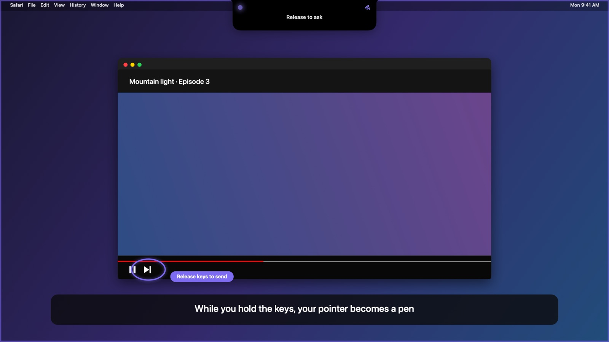

### Hand off a task: "Agent, …"

Start a spoken request with **"Agent"** and Wisp does it in the background: reminders, calendar events,
notes, music, files and web pages. It tells you when it's done. Anything that changes something asks first,
and every action is recorded on the Activity page.

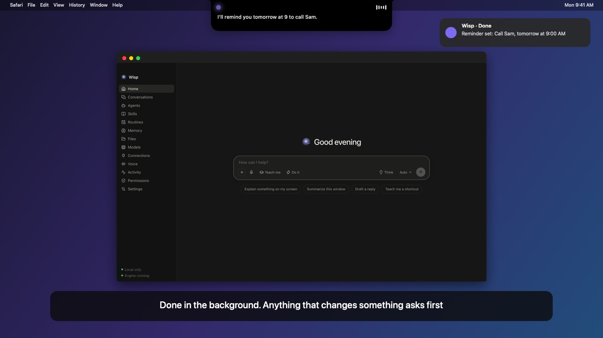

### Dictate into any app

Hold **⌃⇧** and talk; let go and your words are typed where your cursor is, transcribed on your Mac in about
a third of a second. It never types into password fields, and your clipboard is put back afterwards.

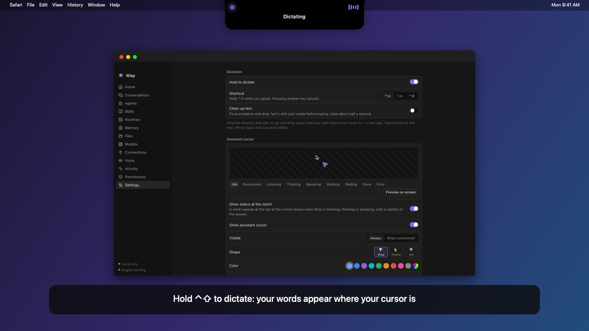

### Talk hands-free

Tap the shortcut twice for a back-and-forth conversation. Wisp listens, answers, then listens again, never
while it's speaking. Press Esc or tap once to stop.

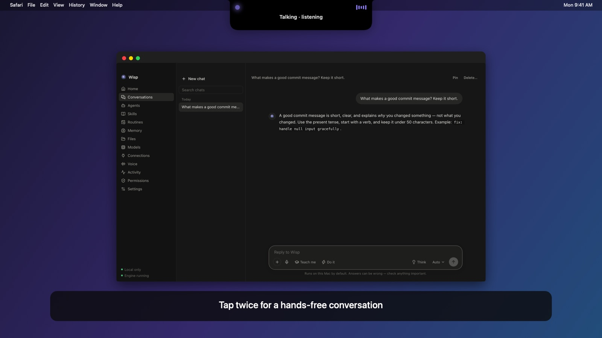

### And more

| | |
|---|---|
| **Teach me** | "Teach me how to…" walks you through one highlighted, spoken step at a time and notices when you've done it. It never clicks for you. |
| **Connections (MCP)** | Connect services such as Notion or GitHub through MCP servers (stdio or HTTP), and choose Ask, Allow or Block for each tool. |
| **Memory** | Remembers what you ask it to, visibly and with Undo, using on-device embeddings. |
| **Files** | Import PDFs and documents; answers cite the passage they came from. Reading and OCR happen on your Mac. |
| **Skills & routines** | Reusable instructions, and scheduled prompts or agents that run in your timezone. |
| **Tips** | Optional: after 10 minutes in an app, offers a short tour of it, once per app. |

---

## The notch

Wisp shows what it's doing in a small capsule that hangs from the notch, like a Dynamic Island: listening,
drawing, thinking, and the spoken answer as a caption. Click it to open the full assistant.

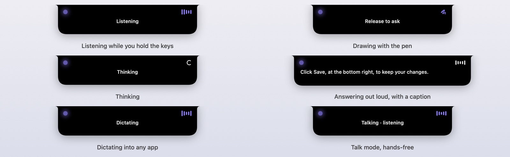

You can turn it off under **Settings → Assistant cursor → Show status at the notch**.

---

## The app

Everything is also available as a regular app: a chat that keeps your conversations, and settings for models,
voices, connections and privacy.

<table>
<tr>
<td width="50%">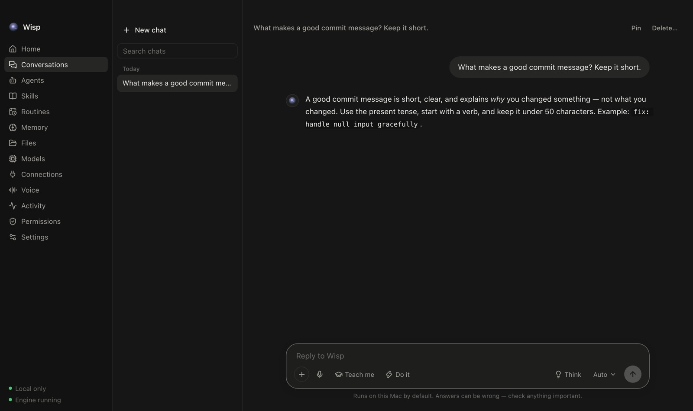<br><sub><b>Chat</b>, answered here by a model running on the Mac</sub></td>
<td width="50%">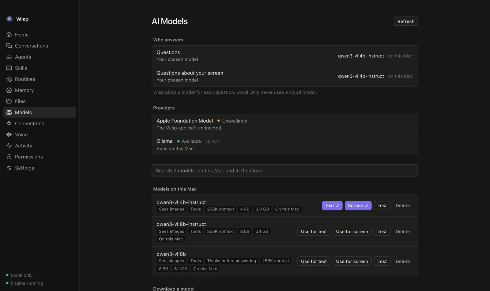<br><sub><b>Models</b>: what answers, one search box, local and cloud models kept apart</sub></td>
</tr>
<tr>
<td>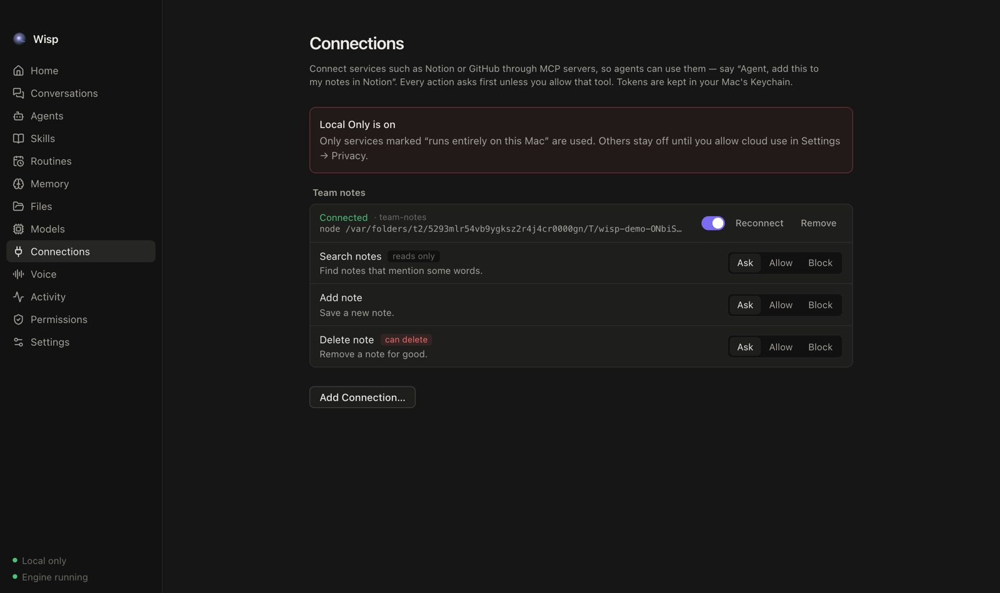<br><sub><b>Connections</b>: MCP tools with a rule each; destructive ones are marked</sub></td>
<td>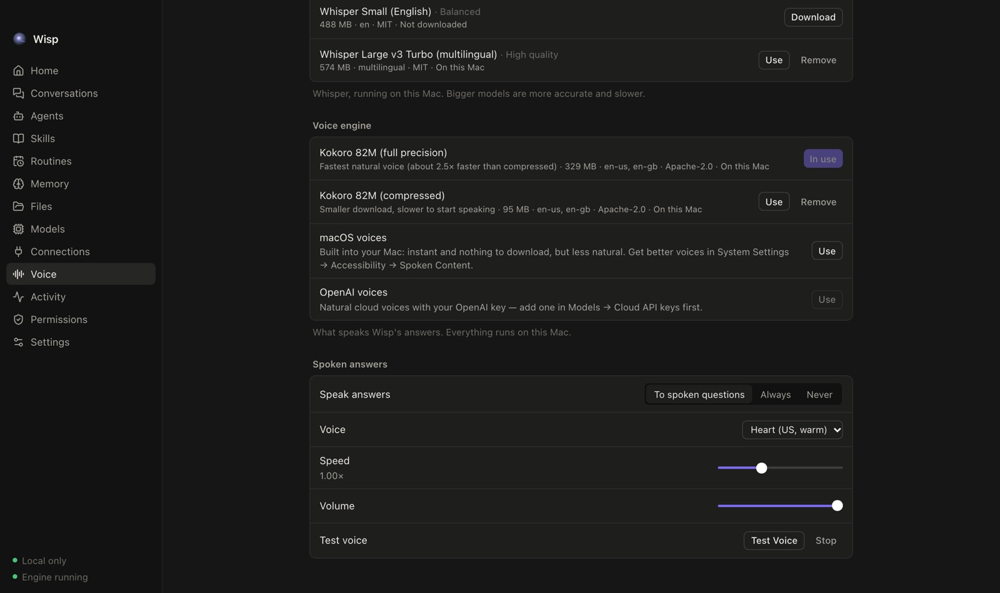<br><sub><b>Voice</b>: speech recognition and the voice that answers</sub></td>
</tr>
<tr>
<td>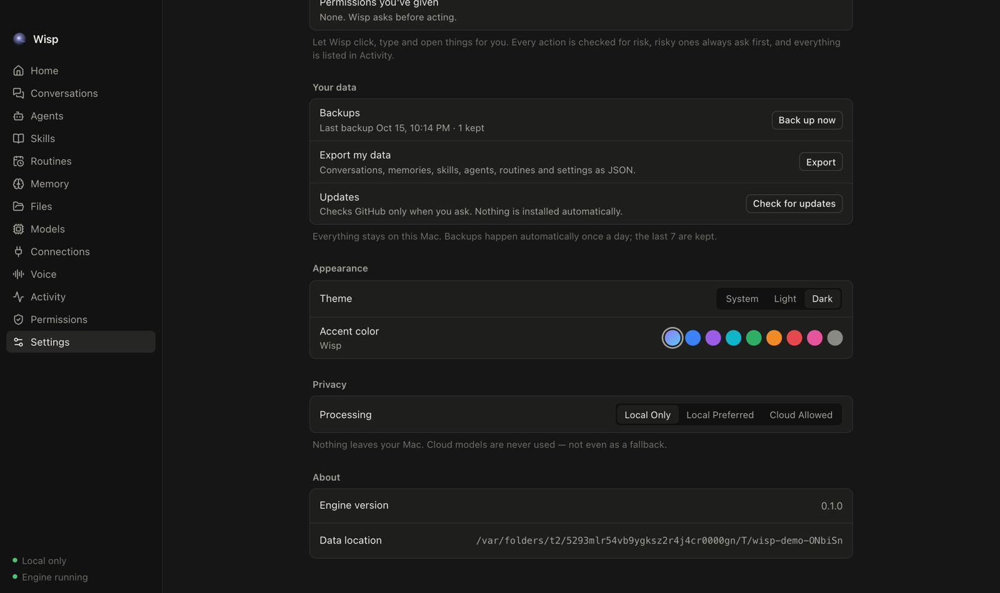<br><sub><b>Settings</b>: Local Only, Local Preferred or Cloud Allowed</sub></td>
<td>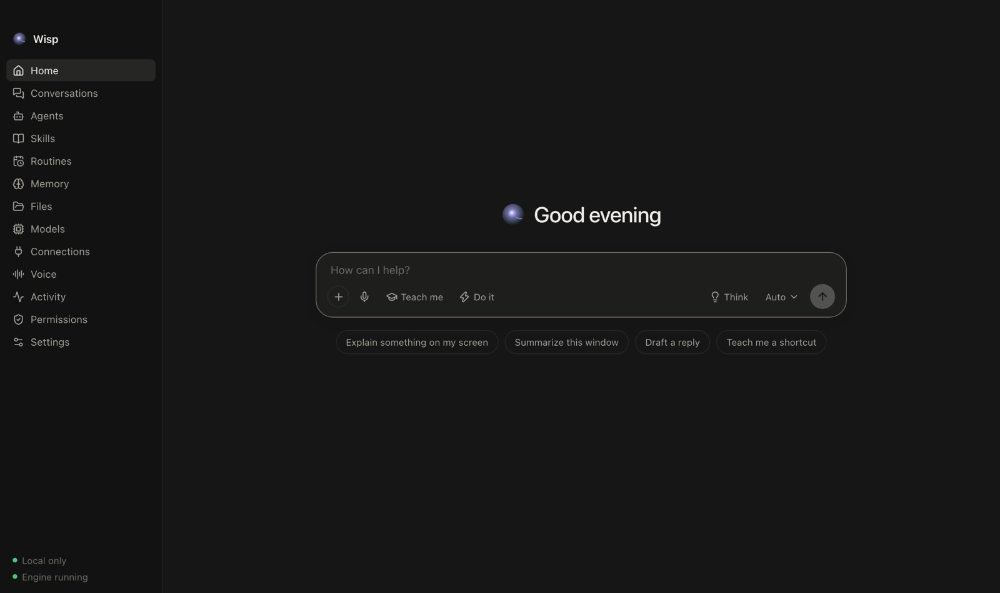<br><sub><b>Home</b>: type instead of talking; Think and Do it are one click away</sub></td>
</tr>
</table>

---

## Shortcuts

| Do this | To |
|---|---|
| Hold **⌥⌘** and talk | Ask about what's on screen (release to send) |
| Hold **⌥⌘** and draw | Point at something with the pen while you ask |
| Tap **⌥⌘** | Open or close the assistant panel |
| Tap **⌥⌘** twice | Start or stop talk mode (Esc also stops) |
| Hold **⌃⇧** and talk | Dictate into the app you're in |
| Say **"Agent, …"** | Run the request as a background task |

All of these can be changed in **Settings → Invocation** and **Settings → Dictation**. A side mouse button can
summon Wisp too.

---

## Models and voices

Wisp picks a model for each question and tells you which one answered and why.

| | Options |
|---|---|
| **On your Mac** | Any [Ollama](https://ollama.com) model. Recommended: `qwen3-vl:8b-instruct` (sees the screen, points accurately) or `qwen3-vl:4b-instruct` (faster). Apple's on-device model on macOS 26. LM Studio, llama.cpp or any OpenAI-compatible server on localhost. |
| **Cloud, with your own key** | OpenAI, Anthropic and Google Gemini. Keys live in your Mac's Keychain, never in settings files. Only used when your privacy setting allows it. |
| **Speech recognition** | Whisper, on your Mac (base.en to large-v3-turbo). |
| **Voice** | Kokoro 82M on your Mac (natural, about 4× faster than real time), the built-in macOS voices, or OpenAI voices with your key. |

**Deep thinking** is a switch: when it's off, a model that always reasons first is swapped for its faster
"instruct" version.

---

## Privacy

- **Local Only is the default.** Cloud providers are never contacted, not even to list their models.
- **Local Preferred** asks before each cloud use; **Cloud Allowed** uses the providers you've set up.
- Screenshots are taken only when you invoke Wisp, never continuously, and Wisp's own floating windows are
  left out of them.
- Everything on screen is treated as data, not instructions: page text can't tell the model what to do.
- Actions that change something ask first; high-risk ones always ask. Everything is logged on the Activity page.
- API keys and connection tokens are kept in the Keychain. Secure text fields are never read.

---

## Install

1. Download the latest `.dmg` from [Releases](https://github.com/SurajMazar/wisp/releases) and drag Wisp to
   Applications.
2. Builds aren't notarized yet, so the first launch is blocked. Either run

   ```bash
   xattr -dr com.apple.quarantine /Applications/Wisp.app
   ```

   or open Wisp once and choose **System Settings → Privacy & Security → Open Anyway**.
3. The first-run guide asks for one permission at a time (Screen Recording, Accessibility, Microphone) and
   offers to download a recommended model.

**Requirements:** macOS 15 or later on Apple Silicon (macOS 26 for Apple's on-device model). Ollama for
local models.

Every push to `main` also produces a downloadable build: open the latest
[CI run](https://github.com/SurajMazar/wisp/actions/workflows/ci.yml) and get the DMG under **Artifacts**.

---

## How it works

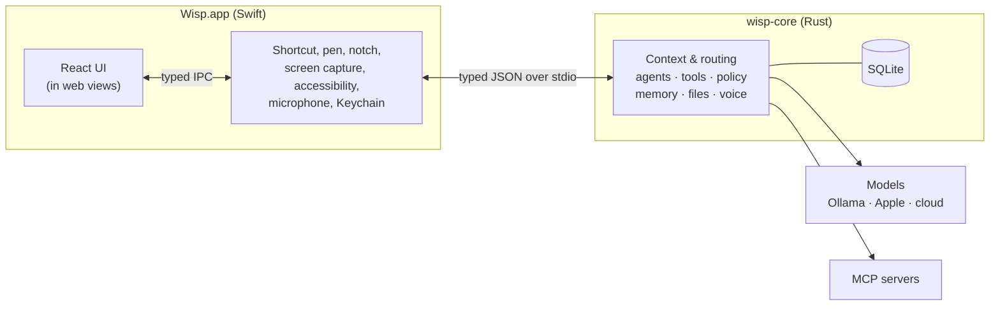

- The **Swift host** is the only code that touches macOS: the global shortcut, the pen overlay, the notch,
  ScreenCaptureKit, accessibility, audio and the Keychain.
- **wisp-core** (Rust) does everything else: builds the context for each question, routes it to a model,
  runs agents through a central approval policy, and stores data in SQLite with forward-only migrations.
- The **React UI** runs inside the host's web views and talks only through typed messages. Contracts are
  generated from the Rust types (Zod for TypeScript, Codable for Swift) and checked for drift in CI.
- While you're still talking, Wisp reads the screen and has the model start on it, so the answer begins sooner.

More: [ARCHITECTURE.md](ARCHITECTURE.md) · [DECISIONS.md](DECISIONS.md) · [docs/](docs)

---

## Development

You need Command Line Tools or Xcode (Swift 6), Rust (pinned by `rust-toolchain.toml`; rustup installs it),
Node 22+ and pnpm 10.

```bash
pnpm install
```

```bash
pnpm dev
```

`pnpm dev` runs Vite with the debug app pointed at it, so the UI hot-reloads.

```bash
pnpm build
```

`pnpm build` validates everything, then builds `build/Wisp.app`.

```bash
pnpm validate
```

`pnpm validate` is what CI runs: architecture rules, contract drift, Rust and TypeScript format and lint,
typecheck, and the Rust, TypeScript and Swift test suites.

To keep macOS permissions across rebuilds, create a local signing identity once:

```bash
scripts/development/create-signing-identity.sh
```

More in [docs/development/README.md](docs/development/README.md).

### CI and releases

- [`ci.yml`](.github/workflows/ci.yml): every push and pull request validates, builds the app, and uploads
  the DMG, ZIP and checksums as an artifact.
- [`release.yml`](.github/workflows/release.yml): pushing a `v*` tag publishes a GitHub Release. Tags with a
  `-` are pre-releases. If Apple Developer ID secrets are configured, it also signs and notarizes.

### Product demo

`pnpm demo:product` builds a narrated product video, `build/demo/wisp-product-demo.mp4`. It uses Kokoro for
the narration, the app's own code to render the notch and pointing, real UI against the engine and a local
model, and ffmpeg to time each scene to its line. The images in this README come from it.

---

## Measuring it

Quality checks that run against the real engine and your local models, in `scripts/validation/`:

| Script | Checks | Last result |
|---|---|---|
| `circle-check.ts` | Circle a button or icon, ask "What is this?" | 10/10 named correctly (qwen3-vl 4B) |
| `point-check.ts` | "How do I pause this video?" on an icon-only player | 6/6 pointed at pause (4B and 8B) |
| `voice-latency.ts` | Release the keys → first spoken word | ~1.5 s with 4B + Kokoro when the screen is read as text |
| `voice-latency.ts --dictate` | Release the keys → dictated text | 0.3–0.4 s |
| `agent-check.ts` | Spoken background tasks (reminders, calendar, music, files, MCP) | 6/6 correct on 4B and 8B |
| `ui-test.ts` | End-to-end UI against the real engine | 43 checks |
| `crates/audio` `transcribe` example | Narration heard back by Whisper | 0.9% word error rate |

---

## Repository

| Path | What lives there |
|---|---|
| `apps/macos` | Swift host: the only code that touches macOS APIs |
| `apps/web` | React UI |
| `crates/*` | Rust runtime (the `wisp-core` binary is in `crates/core`) |
| `packages/contracts` | Generated, validated IPC contracts (Zod) and a typed client |
| `packages/ui`, `icons`, `config`, `test-utils` | Design system and shared tooling |
| `database/migrations` | Forward-only SQL migrations embedded in `wisp-core` |
| `models/manifests` | Model metadata and checksums (never the models themselves) |
| `scripts/` | Build, release, validation and demo scripts |
| `docs/` | Subsystem documentation |

## License

Not yet licensed. See [LICENSE](LICENSE).
